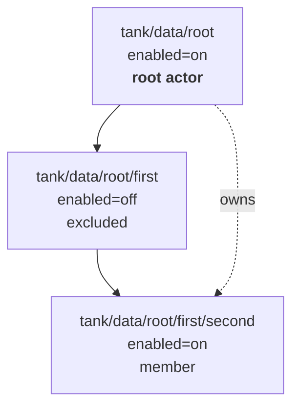

# Design: root actor scope

Status: implemented on this branch. Re-derived against `main` at `bbc266c`;
sections 3.4, 6 and 6.1 record decisions the implementation forced.

This replaces the model in which every descendant inheriting
`org.boomerangz:enabled=on` becomes a peer actor with one in which a single
root owns its whole subtree. It is a breaking change to ownership semantics.
There are no known users, so no migration path is provided.

## 1. The problem

### 1.1 The incident

A freshly adopted local backup target wedged with three jobs that no retry
could clear. The source was `zroot/data/home/pdf`, `local=storage/backup`,
`discard=first`, `replicate=off`, with `pdf`, `.local` and `.local/share` all
active:

- `local:zroot/data/home/pdf:storage/backup` blocked: `target identity or
  mapping differs from persistent binding; run boomerangz dataset reseed for
  this source and target`.
- `local:zroot/data/home/pdf/.local:storage/backup` blocked: `cannot open
  'storage/backup/data/home/pdf/.local': dataset does not exist`.
- `local:zroot/data/home/pdf/.local/share:storage/backup` in `waiting-retry`
  behind the above.

The trigger was a reseed of the parent. `ReseedService.Apply` destroys the
mapped destination recursively
([reseed.go:202](../internal/transfer/reseed.go)), then releases references,
clears the suspension marker and removes the binding property for
`request.Source` alone; `plan()` never enumerates descendant sources holding
their own bindings to the same target. A parent reseed therefore destroys
every descendant's replica while leaving every descendant's source-side state
pointing at datasets that no longer exist.

`.local` held a promoted binding anchored at its own mapped dataset, destroyed
underneath it. `pdf` held a fresh bootstrap binding anchored at an ancestor,
which cannot revalidate once its mapped destination exists again.

### 1.2 The root cause

`ActiveRoot` accepts activation inherited from any ancestor
([authority.go:19](../internal/lifecycle/authority.go)):

```go
if source == "" || (source != root && !strings.HasPrefix(root, source+"/")) {
```

So `enabled=on` at one dataset silently promotes every descendant into a full
peer actor with its own lineage, binding, reference set, schedule and job.
Nothing models the relationship between them, so every ordering and
consistency requirement is reconstructed downstream from string prefixes:

| Reconstruction | Location | Re-derives |
| --- | --- | --- |
| `missingMappedAncestor` | [runtime.go:935](../internal/daemon/runtime.go) | parent-before-child transfer ordering |
| `nearestReceiveLockScope` | [runtime.go:923](../internal/daemon/runtime.go) | which lock a transfer contends on |
| `prepareReceiveParents` | [local.go:381](../internal/transfer/local.go) | placeholder ancestors, which can collide with another actor's mapped destination |
| bootstrap anchor revalidation | [binding.go:104](../internal/transfer/binding.go) | that peers may populate the destination namespace |
| bootstrap vs promoted binding | [plan.go:294](../internal/transfer/plan.go) | destination authority |
| reseed destroy scope | [reseed.go:202](../internal/transfer/reseed.go) | subtree ownership, incorrectly |

Six mechanisms reconstructing one missing edge. All six are present on `main`.

### 1.3 The concept exists, gated on the wrong thing

`discovery.Entry.CoveredBy` already is a root actor, and `isSchedulable` drops
covered datasets outright ([scheduler.go:58](../internal/daemon/scheduler.go))
- no lineage, no binding, no references, no job. That is the target model.

`markReplication` only ever sets it when the parent resolves
`Send.Replicate` ([discovery.go:446](../internal/discovery/discovery.go)).
Coverage is gated on the wire format rather than on ownership, so exactly the
layouts that cannot use `-R` are the ones left in the peer-actor model.

## 2. ZFS constraints

`send -R` forces one flag set over the whole subtree: if any descendant is
encrypted the entire stream must be raw, which forces `large_blocks`,
`compressed` and `embedded_data` on. `ForReplicationScope`
([resolve.go](../internal/policy/resolve.go)) implements this. Per-dataset send
options are not expressible, `props` is not independently controllable, and
neither `zfs snapshot -r` nor `zfs send -R` accepts an exclusion. A `-R` root
therefore cannot have a sparse member set, which is why sparse layouts run
under `replicate=off` today and so land in the peer-actor model.

`zfs snapshot` accepts several snapshot names in one invocation and creates
them atomically in a single transaction group:

```
zfs snapshot tank/a@name tank/b@name tank/c@name
```

That is strictly more capable than `-r` here: atomic across an arbitrary
sparse set, with `-o` applied uniformly. It replaces `-r` in both modes, since
under `replicate=on` the enumerated subtree is deterministic where `-r` is
not, and `CreateSnapshot` already re-reads and compares the scope either side
of creation. The cost is argument length: at roughly 60 bytes per name a 2 MiB
`ARG_MAX` holds some tens of thousands of datasets, which is accepted rather
than worked around.

## 3. The model

> A dataset is an actor root if and only if it is enabled and has no enabled
> ancestor. `org.boomerangz:enabled` is a per-dataset include/exclude switch
> with normal ZFS inheritance.

An intervening `enabled=off` does not sever a deeper enabled dataset from its
root. That is deliberate and it is the opposite of today's rule. Severing
would make the deeper dataset an independent actor nested inside another
actor's subtree, with its mapped destination inside the outer root's mapped
destination - which is the overlapping-ownership problem this document exists
to remove, reintroduced one level down.

No new property is added. Activation stays a single `zfs set`, which matters
because the property is the whole interface; there is no enable command.

### 3.1 Member sets

Given `tank/data/root` enabled, `tank/data/root/first` off and
`tank/data/root/first/second` enabled, the member set is
`{root, second}` - sparse, with a hole at `first`. Today `second` resolves as
an independent peer root; here it is a member of `root`.



### 3.2 Modes

`replicate` selects member-set derivation and wire format. Both are root
actors.

| | `replicate=off` (default) | `replicate=on` |
| --- | --- | --- |
| Members | sparse: the subtree minus locally disabled datasets | the entire subtree, unconditionally |
| Snapshot | atomic multi-dataset over the member set | atomic multi-dataset over the subtree |
| Stream | one per member, parent-first, per-member send options | one `send -R`, uniform flags |
| Descendant `org.boomerangz:*` | honoured | ignored, warned |
| Source-side deletes | explicit member reconciliation | `recv -F` propagation |

A member keeps its own send options, targets and retention grid. Pruning is
per member against that member's grid. A member does not get its own lineage,
binding or snapshot instant; those are root-scoped.

Holes cannot exist under `replicate=on`: an excluded descendant and everything
beneath it enter the stream anyway, so it gets a warning of its own rather
than appearing as `governs differing enabled` among send-option overrides.
Copying data the operator explicitly excluded is a different class of
consequence from an overridden send flag.

### 3.3 Nested independent actors

Not expressible, by construction: a dataset with an enabled ancestor is a
member. If one is ever wanted it needs an explicit `org.boomerangz:root=on`
opt-in and the ordering edges between overlapping roots that go with it.
Deferred until there is a case. Under the rule above there are no cross-actor
edges at all, so no dependency graph is needed.

### 3.4 Partial member failure

The snapshot is atomic; the N streams under `replicate=off` are not, and with
per-member cadence (section 5) members are routinely at different snapshot
instants anyway. A destination of a sparse root is never one point in time,
so there is no set-wide invariant to protect by holding verified members back.

Each member's stream therefore advances its own proof (section 6) when it
verifies, independently of the others. A stream that fails leaves every
stream beneath it unattempted: a deeper member would be received into a
placeholder at the failed member's mapped name, which would then block that
member's own later full receive. Unrelated streams still run. A retry resumes
or re-plans only what did not verify.

Under `replicate=on` there is one stream and one proof, so the whole subtree
advances together, as before.

## 4. Authority

Root-ness needs the tree, so it is decided in discovery, which has it.

This collapses rather than relocates the `ActiveRoot` reconstruction. A root
has no enabled ancestor, and `policy.Resolve` inherits only locally configured
public values, so a root's `enabled` always resolves from its own local
property. The prefix walk becomes an equality:

```go
effective.Values[policy.Namespace+"enabled"].Dataset == root
```

That is necessary but not sufficient - a descendant may also set `enabled=on`
locally while having an enabled ancestor - so discovery decides root-ness and
`ActiveRoot` keeps the local check. The CLI already refuses datasets with
`CoveredBy` set ([identity.go:73](../internal/cli/identity.go)), so extending
coverage to every member makes member-targeted commands refuse without
further work.

## 5. Scheduler

The concurrency structure is unaffected: `Next` scans entries, arms one timer
and wakes on a broadcast channel, and its single consumer submits a job and
loops. Entry counts fall, because `isSchedulable` already drops covered
datasets and every non-root member is now covered.

What does not survive is one cadence per entry. `cadence` comes from
`Grid.Cadence()`, which returns `buckets[0].Span`
([grid.go:104](../internal/policy/grid.go)) - one number per root. Per-member
grids cannot pass through it: `Schedule` carries no member set, so a fired
tick cannot say which members are due, and `Complete(dataset, completed)`
advances a single deadline by a single cadence.

One `next` per root, equal to the earliest member deadline; compute the due
subset when the tick fires; `Complete` advances per-member state. `Next`, the
pending flag and the wake channel are untouched.

Collapsing a grid to its finest bucket is sound within one grid - buckets sort
ascending, so any window of length `Span` contains a point of a
`Cadence()`-spaced sequence - and `Prune` anchors windows to the newest owned
snapshot rather than to wall-clock boundaries, so there is no alignment for
drift to break. But the collapse is a cost property, not a correctness one,
and it does not survive being extended across members: a root ticking at the
minimum cadence over its members and snapshotting all of them gives a `14x1d`
member 288 snapshots a day to retain 14, and `enqueueTransfers` fires after
each successful snapshot, so it sends 288 times too. Hence per-member.

## 6. State

`state:lineage`, `state:owner`, `state:target:*` and `state:reference:*` exist
only on roots; members carry none.

A reference is the proof for one stream's endpoint on one target. It is keyed
by target, stream and snapshot instant -
`state:reference:<target id>:<stream id>:<instant>` - where the stream is the
member it sends from, or the root for a replication root. Keying by instant
alone, as before, assumed every member shares every instant; per-member
cadence makes that the exception, and one member's proof must never retire
another's base.

`Sources` is unconditional and canonical: the stream's own snapshot first,
then, for a `-R` stream only, its descendants' snapshots at the same instant,
sorted. The singular `GUID` field is removed rather than kept as a copy of
`Sources[0]` that nothing checks; `GUID()` reads the stream's own source. The
back-fill of `Dataset` for pre-authority records is deleted under this
document's no-users stance.

### 6.1 Transfer

A transfer of one root to one target is a sequence of streams, parents first:
each member that sends to the target, or the root alone. A member stream is
the existing single-dataset stream with everything that defines ownership
taken from the root: authority, lineage, suspension, the target binding, and
the receive mapping. Its own policy supplies only send options, incremental
mode and receive overrides. A member may send to targets the root does not;
the binding and proofs for such a target still live on the root.

Every stream, the root's included, receives into exactly the destination the
planner computed: the root's mapped dataset plus the stream's path relative to
the root. Receive no longer derives a destination from the stream's own name
with `-d` or `-e`. That was a second mapping rule that had to agree with the
first, and for a member under `discard=all` it does not: the member would land
beside the root's replica rather than beneath it.

The binding proves the root's mapped destination whichever stream is being
planned, and the first stream to bring that destination into existence -
including by creating it as a placeholder for a member - promotes a bootstrap
anchor to it.

Pending work is per stream, keyed by the stream's dataset. A job reserves each
stream's pending endpoint and completes each stream that verified the exact
endpoint it carried, whether or not its siblings did.

Resume is per stream. A non-recursive stream owns only the resume token on its
own destination; a token on a descendant belongs to that member's stream. A
token is validated against that stream's proofs alone, and after resuming the
stream plans again, so it ends at its newest endpoint in the same attempt.
This settles the earlier draft's open question about resume within a member
set: members that never streamed are no longer checked against a token they
had nothing to do with.

## 7. Removed

- `missingMappedAncestor` and `missingLocalDestinationAncestor`: intra-root
  ordering is internal to one actor's transfer, not reconstructed across jobs.
- The `waiting-retry` "waiting for destination ancestor" outcome.
- Receive mapping by `zfs receive -d`/`-e`: every stream receives into its
  planned destination exactly (section 6.1).
- `recursive bool` on the snapshot seam and every `-r` snapshot path.
- Reseed's cascade: destroy scope and cleanup scope are the same member set by
  construction.

Retained:

- `ForReplicationScope`, scoped to `replicate=on`, where it is the honest
  consequence of a single stream rather than a workaround.
- `nearestReceiveLockScope`: contention between distinct roots mapping into
  one destination namespace is real and unrelated to nesting.
- `prepareReceiveParents`, unchanged in mechanism. A hole's mapped destination
  must exist for a deeper member to be received, and under this model no actor
  claims the hole's mapped name. Peer actors claiming each other's mapped
  destinations is what made the same mechanism dangerous.
- **The bootstrap versus promoted binding asymmetry at
  [plan.go:294](../internal/transfer/plan.go).** This is a change of position
  from the earlier draft of this document, which proposed removing it. The
  asymmetry refuses to let an ancestor-only bootstrap binding authorise a
  destination that has since come into existence, and that is not only about
  peers materialising each other's destinations: it also covers a destination
  destroyed and recreated outside boomerangz entirely.
  `TestGuestDaemonPowerLoss/receive-commit` pins an independent route into the
  same blocked state - a crash between a bootstrap receive committing and the
  transfer verifying - on a single root with no descendants, which this model
  does not touch. The binding contract is therefore unchanged and that test is
  not inverted.

## 8. Bugs on `main` fixed here

- Under `replicate=on`, a newly created snapshot's pending protection
  inspected the root non-recursively and then searched that state for its
  children's snapshots, so only the root's snapshot was held. The transfer's
  own proof for the same instant covered the subtree under the same key and
  conflicted with it. `TestReplicationRootPendingProtectionHoldsTheSubtree`.
- Under `replicate=on`, pruning planned only the root's own snapshots. The -R
  snapshot lands on every descendant and nothing else pruned those, so they
  accumulated without bound. `TestReplicationRootPrunesEveryDescendant`.

## 9. Known gaps, not fixed here

### 9.1 Colliding destination mappings

Fixed after this document was first written: discovery now invalidates roots
whose replicas overlap. See [destination-collisions.md](destination-collisions.md).

### 9.2 A placeholder blocks its dataset's own later replica

Fixed after this document was first written. Every receive parent is created
with `state:placeholder=on` in the same `zfs create`, so a placeholder is
provably boomerangz's and provably never a replica. When a stream's destination
is still a placeholder - a hole that became a member, or the root's replica on
a target only members used before - the placeholder moves aside to a sibling,
the stream's ordinary full receive creates the replica, and once it verifies
the placeholder's children move beneath it and the empty placeholder is
removed. Each step leaves a state the next attempt recognises; nothing is
destroyed until the placeholder is empty. A placeholder with a resumable
receive beneath it defers only its own stream, so that receive can finish.

A placeholder is never a binding anchor: the root's destination identity is
the nearest real dataset, so a member-only target binds to the real ancestor
and the root joining it later is an ordinary bootstrap. A reseed during a
replacement of the root's own replica destroys the set-aside placeholder with
it, since it lies beside the root's replica rather than inside it.

### 9.3 Bootstrap crash window

`TestGuestDaemonPowerLoss/receive-commit` pins a crash between a bootstrap
receive committing and the binding being promoted: the next pass finds the
mapped destination present under an ancestor-only binding and blocks for a
reseed. The binding contract is unchanged (section 7), so that still holds. A
member-only target does not add a route into it: the root's placeholder is
never mistaken for its replica (9.2).

### 9.4 A failed resume is sticky

`Apply` takes the resume path whenever a stream's destination holds a token,
and a `BuildResume` failure is returned with no fallback, so the error repeats
for as long as the token exists. Giving it a recovery means aborting the
token, which contradicts `Apply`'s contract that failures retain references
and any receive token with no implicit reseed or abort. That is a policy
decision, not a cleanup. Its reach is now one member's stream rather than the
root's whole transfer.

### 9.5 Member-only targets on a root replicated to the configured root

Under `discard=off` the root's replica is the configured destination root
itself. If only a member sends to a remote target, nothing creates that root,
and SSH and native destinations refuse to create their configured root. The
transfer fails with that refusal; the remote root has to be created by hand.
